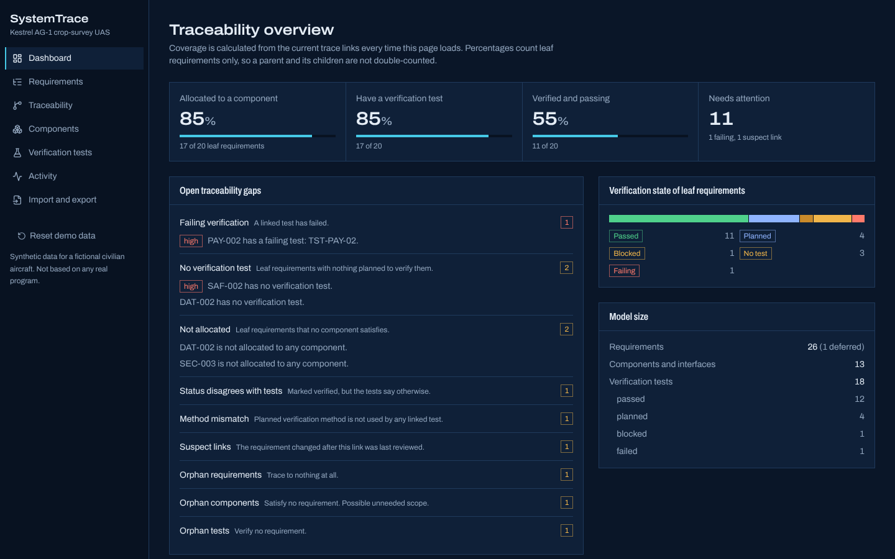
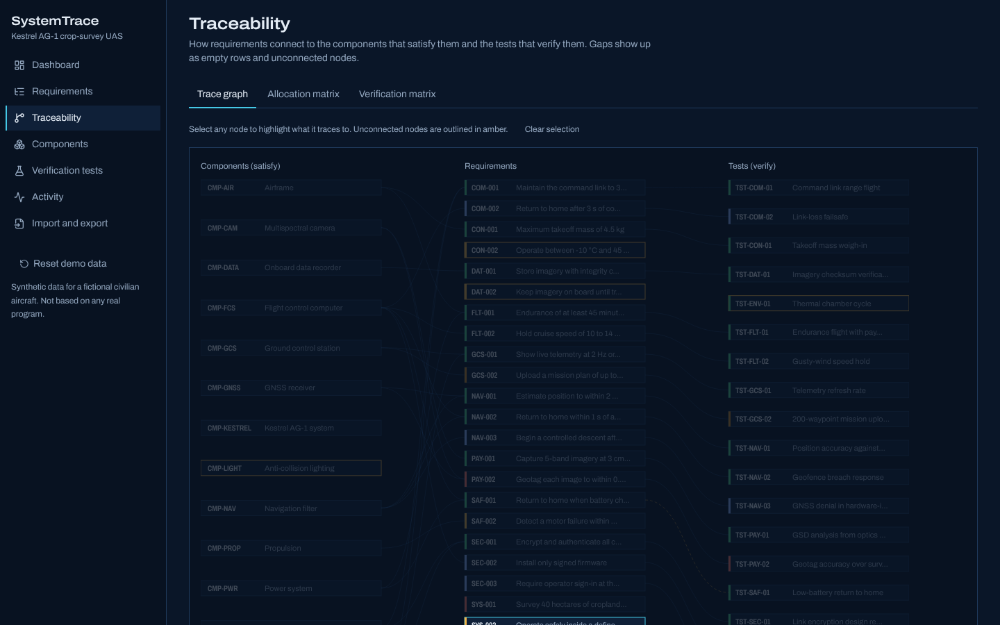
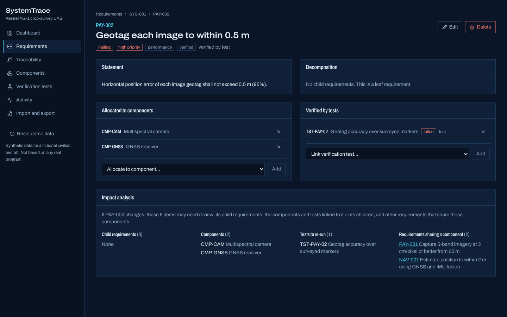
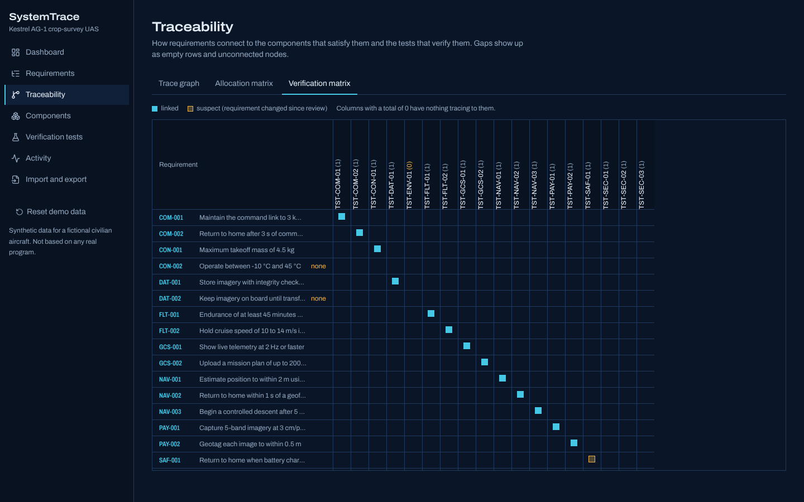
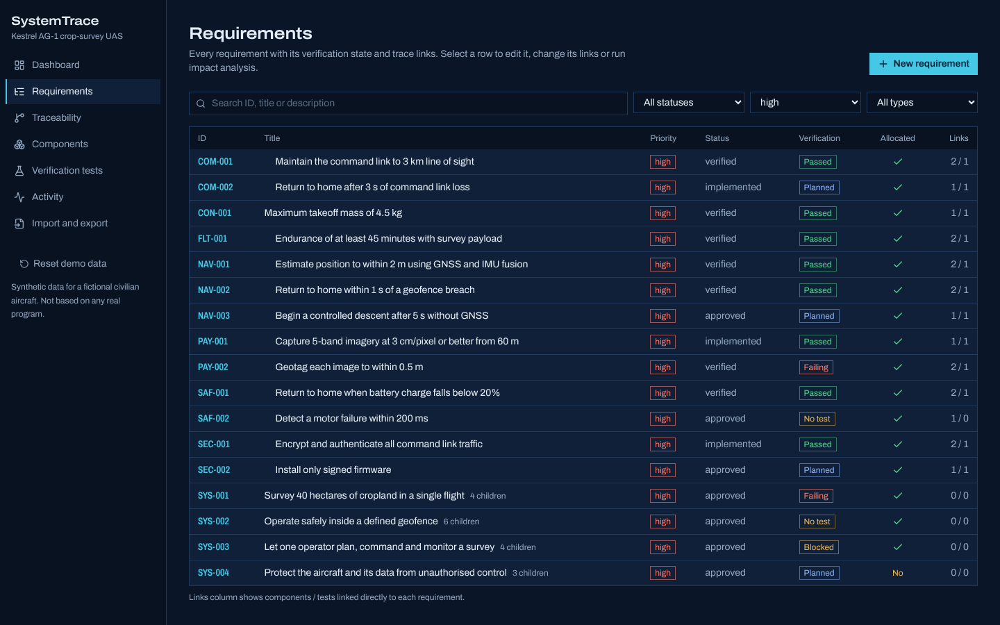
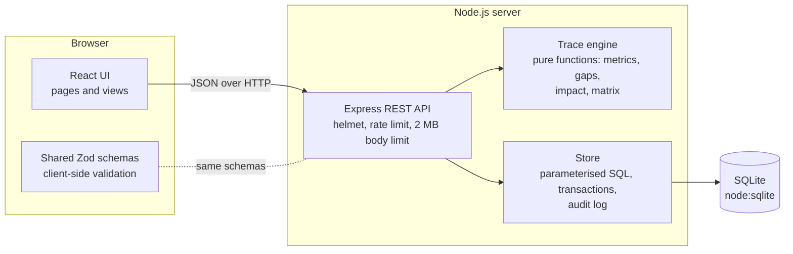
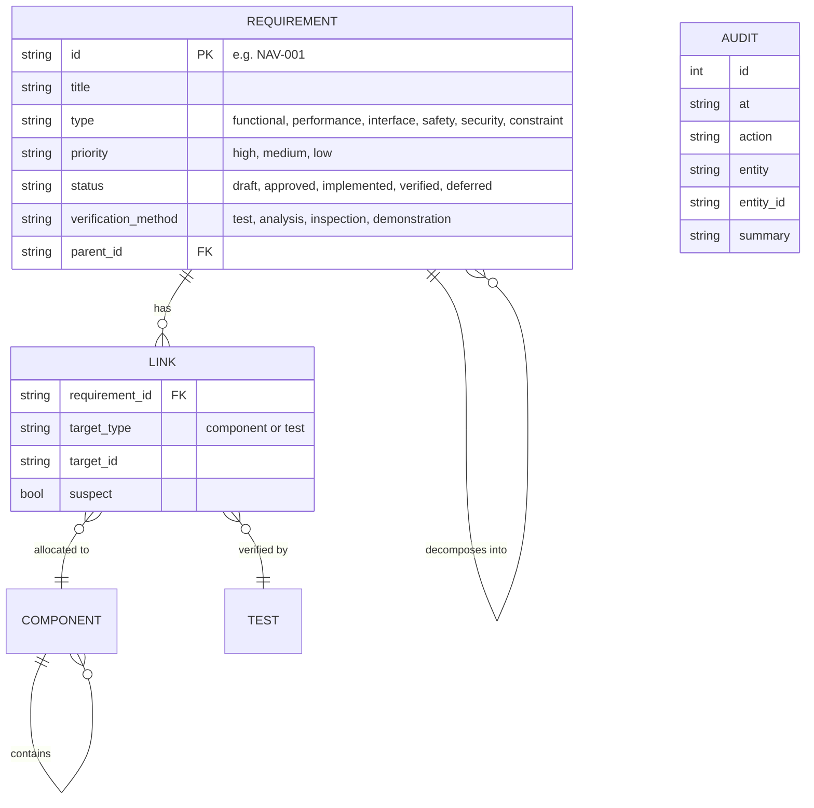
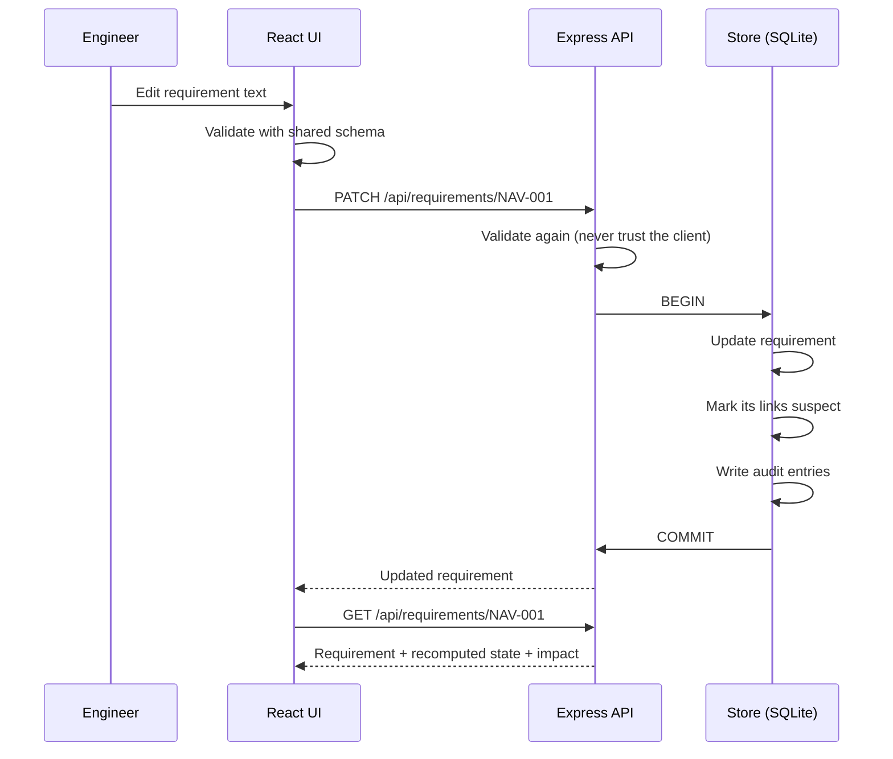

# SystemTrace

**Requirements traceability for model-based systems engineering.** SystemTrace links every system requirement to the components that satisfy it and the tests that verify it. It then shows you, from live data, what is unallocated, what is unverified, what is failing and what a change would affect.



> This is an independent portfolio demonstration. It ships with a synthetic model of **Kestrel AG-1**, a fictional civilian crop-survey drone. None of it is based on any real program, employer or product.

## Why traceability matters

In a design review, the questions that matter are rarely about any one requirement. They are about the connections:

- **Is every requirement satisfied by something in the design?** If not, there's a gap in the architecture.
- **Is every requirement proven by a test, analysis, inspection or demonstration?** If not, it can't be signed off.
- **If this requirement changes, what else has to change?** That's impact analysis. Without it, a "small" change can quietly invalidate verification work that has already been done.
- **Is anything in the design not traced to a requirement?** That might be unneeded scope, or it might be a missing requirement.

SystemTrace answers those questions directly, and it recomputes every answer from the trace links each time you ask.

## Features

| Area | What you can do |
|---|---|
| Requirement register | Create, edit and delete requirements with IDs, type, priority, status, planned verification method, rationale and parent/child decomposition |
| Trace links | Allocate requirements to components and interfaces; link them to verification tests |
| Gap analysis | Find unallocated and unverified leaves, failing tests, method mismatches, "verified" requirements that aren't, and orphan requirements, components and tests |
| Suspect links | Editing a requirement's text marks its links suspect until someone reviews them, like suspect links in DOORS |
| Impact analysis | For any requirement: its ancestors and descendants, affected components, tests to re-run, and other requirements that share those components |
| Traceability views | An interactive three-column trace graph, plus allocation and verification matrices |
| Dashboard | Coverage metrics computed from live data, with leaf-only counting so parents aren't double-counted |
| Import and export | Full-model JSON, requirements CSV with formula-injection protection, and all-or-nothing imports that report errors row by row |
| Audit history | An append-only log of every create, update, delete, link, review and import |

<table>
<tr>
<td></td>
<td></td>
</tr>
<tr>
<td></td>
<td></td>
</tr>
</table>

## Architecture



The **trace engine** (`src/shared/trace.ts`) is the heart of the project. It's a set of pure functions over an in-memory model, so the same rules run in the API, the UI and the unit tests. Nothing derived is ever stored. Metrics, gaps and impact sets are recomputed from the links on every request, so a dashboard number can't drift out of date.

### Data model



### Request flow for a change



### Technology choices

| Choice | Why |
|---|---|
| TypeScript end to end | One set of types and Zod schemas shared by client, server and tests |
| Express 5 | Small, well understood, and it handles errors from async routes natively |
| SQLite through `node:sqlite` | Relational integrity and transactions with no database server and no native module to compile. The trade-off: `node:sqlite` is still flagged experimental in Node 22 |
| React + Vite | A fast build and a simple component model; the interactive graph is hand-built SVG rather than a heavy graph library |
| Vitest + Supertest | Unit tests for the rules, and HTTP-level tests against a real in-memory database |

The traceability rules, including exactly how coverage is calculated, are in [docs/traceability-rules.md](docs/traceability-rules.md). Every endpoint is listed in [docs/api.md](docs/api.md).

## Getting started

Requirements: **Node.js 22.13 or newer** (for the built-in SQLite driver).

```bash
git clone https://github.com/<your-username>/systemtrace.git
cd systemtrace
npm install
cp .env.example .env        # optional; the defaults work
npm run dev                 # API on :3001, web app on http://localhost:5173
```

The database is created at `./data/systemtrace.db` and loaded with the Kestrel AG-1 model the first time. To start over, use **Reset demo data** in the sidebar, or run `npm run seed`.

### Production build

```bash
npm run build      # builds the client to dist/client and the server to dist/server
npm start          # serves the API and the built client on http://localhost:3001
```

### Docker

```bash
docker build -t systemtrace .
docker run -p 3001:3001 -v systemtrace-data:/data systemtrace
```

The image is a multi-stage build. It ships production dependencies only, runs as the unprivileged `node` user, keeps data in a volume and has a health check.

## Testing

```bash
npm test               # 52 unit and API tests
npm run test:coverage  # with a coverage report in coverage/
npm run lint
npm run typecheck
```

The tests cover the rules that matter most if they're wrong: verification roll-up, leaf-only coverage, deferred-requirement handling, each gap type, impact analysis, cycle prevention, CSV round-trips and injection handling, suspect-link behaviour, transactional rollback on a bad import, validation errors and security headers. Current line coverage of the server and shared code is about 85%.

[GitHub Actions](.github/workflows/ci.yml) runs lint, type checks, tests with coverage, the production build and `npm audit` on every push. It then builds the Docker image and smoke-tests it.

## Deployment

The app is a single Node process with a SQLite file, so any host that runs a container or Node 22 will do. For a free public demo:

1. Push the repository to GitHub.
2. On [Render](https://render.com), create a **Web Service** from the repo, choose the Docker runtime, and set `DEMO_MODE=true`.
3. Render's free tier has no persistent disk, so the database resets on each restart. With `DEMO_MODE=true`, the demo also resets itself every hour, which suits a public demo that anyone can edit.

Free instances go to sleep when idle, so the first request after a while can take up to a minute.

## Security and privacy

- All input is validated with Zod schemas on the server, whatever the client sends. IDs are restricted to a strict pattern.
- All SQL is parameterised. Search text is escaped so `%` and `_` match literally.
- Multi-step writes run in transactions, so an import either fully succeeds or changes nothing.
- `helmet` sets a strict Content Security Policy and other security headers, and `x-powered-by` is removed.
- API rate limiting (300 requests per minute per IP) and a 2 MB request body limit.
- CSV export prefixes cells that start with `=`, `+`, `-` or `@` so spreadsheets don't run them as formulas.
- Errors return a clear message without stack traces or internals.
- No secrets are needed. `.env` is git-ignored, and `.env.example` documents every setting.

**Not included:** user accounts and authorisation. SystemTrace is a single-team tool as written. Anyone who can reach it can edit it, which is why the public demo resets itself. Adding authentication (OIDC) and per-project permissions is the first item on the roadmap.

## Limitations

- No authentication or multi-user conflict handling (last write wins).
- One model per database. There are no projects, baselines or branches.
- The audit log records what changed and when, but not the before and after values, and not who made the change.
- The trace graph is designed for models up to a few hundred items. Very large models need clustering or filtering.
- `node:sqlite` is experimental in Node 22. If its API changes, `Store` is the only file that touches it.
- There's no direct SysML or ReqIF import yet. Exchange is through JSON and CSV.

## Roadmap

- Authentication and role-based permissions (viewer, engineer, reviewer)
- Baselines: freeze a version of the model and compare two baselines
- ReqIF import and export for exchange with DOORS and other tools
- Before and after values in the audit history
- Verification evidence attachments

## License

MIT. See [LICENSE](LICENSE).
